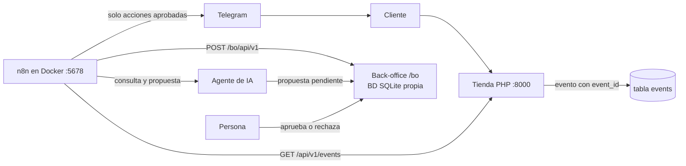

# Zapatero

## Mejoras de políticas, Telegram y publicación

La ruta `/politicas` y el pie común explican el funcionamiento, los pagos y envíos simulados, el soporte y el uso exclusivo de datos de prueba. La API de vinculación de Telegram exige el token de un solo uso: se retira el contrato antiguo que aceptaba solo un código de pedido.

Las mejoras se integran sobre la versión del equipo en `fe1307d`, conservando sus APIs y cambios de datos. `composer test` incorpora una suite HTTP para comprobar la navegación y los rechazos de vinculación sin modificar el chat.

La configuración de n8n está publicada por separado en la rama `codex/despliegue-n8n-irene` del fork de Irene. Su estado y las instrucciones de DonDominio figuran en [la guía de publicación](docs/despliegue-publico.md) y [la actualización del hosting](docs/actualizacion-dondominio.md). El 04/11/2026 se verificaron la publicación de n8n y back-office, siete comprobaciones públicas y una ejecución de lectura desde Render a DonDominio. WF1-WF3 están importados y sin publicar; la demostración con IA y Telegram requiere completar sus credenciales y pruebas conjuntas.

La [memoria](docs/memoria.md) y el [anexo de IA](docs/anexo-ia.md) describen el estado comprobado. Los PDF se generan con `python scripts/generar-documentos.py` (ReportLab) en `output/pdf/`. El [guion de pruebas](docs/pruebas-y-defensa.md) distingue las comprobaciones locales de los escenarios externos pendientes.


Prototipo académico de eCommerce (Soluciones Informáticas para la Empresa, UCAM). **Sin actividad comercial real**: los pagos son simulados y todos los datos son ficticios. La propia web lo indica en una franja visible en todas las páginas.

- **Tarea 1:** canal digital de venta (tienda, carrito, pago simulado, back-office, eventos de negocio).
- **Tarea 2:** integración con un back-office, automatización con **n8n**, **agente de IA supervisado**, avisos por **Telegram** y cuadro de mando con métricas reales.
- **Stack:** PHP 8.1+ · Slim 4 · SQLite (PDO) · plantillas PHP · n8n (Docker) · Telegram Bot API · modelo de lenguaje con API compatible con OpenAI (Gemini, Groq u Ollama).
- **URL pública de la Tarea 1:** _(completar si procede; la Tarea 2 se ejecuta en local)_

> README de la Tarea 1 (despliegue en DonDominio, correo, etc.): [docs/README-tarea1.md](docs/README-tarea1.md).

## Arquitectura de la Tarea 2



1. La tienda registra cada acción como evento con un `event_id` único (`evt_` + 32 hex).
2. n8n lee los eventos nuevos con un **cursor** (cada minuto) o los recibe por **webhook**, los valida y los transforma.
3. Crea o actualiza pedidos y tickets en el **back-office** (`/bo`, con base de datos propia). Cada ejecución, correcta o fallida, queda en el log de integración.
4. Para incidencias, un **agente de IA** consulta el pedido y el cliente, clasifica el caso y **propone** una respuesta. Nace en estado `pending_review`.
5. **Una persona aprueba o rechaza** la propuesta en `/bo/agente`. Solo las aprobadas se envían al cliente por Telegram.
6. `/bo/metricas` muestra indicadores calculados con los datos que genera el propio sistema.

Documentación detallada: [contrato de integración](docs/contrato-integracion.md) · [justificación de métricas](docs/metricas-justificacion.md) · [n8n: workflows, payloads y pruebas](n8n/README.md).

## Qué necesitas

| Programa | Para qué | Comprobación |
|---|---|---|
| PHP 8.1 o superior con `pdo_sqlite`, `sqlite3`, `mbstring`, `openssl` y `curl` | Tienda y back-office | `php -v` y `php -m` |
| [Composer](https://getcomposer.org/) | Dependencias de PHP | `composer -V` |
| [Docker Desktop](https://www.docker.com/products/docker-desktop) | Ejecutar n8n | `docker --version` |
| Cuenta de Telegram | Crear **tu propio bot** con @BotFather | — |
| Clave de un modelo de lenguaje (opcional) | Agente de IA real. Sin ella, el agente entra en **modo seguro** | Ver paso 4 |
| Git | Descargar y subir el código | `git --version` |

Cada persona debe usar **su propio bot de Telegram y su propia clave de modelo**: si dos instancias de n8n leen el mismo bot, Telegram devuelve un error de conflicto y se pierden mensajes.

## Puesta en marcha

Los comandos son de PowerShell (terminal de VS Code en Windows), ejecutados desde la raíz del proyecto. En macOS o Linux, cambia `Copy-Item` por `cp`.

### 1. La tienda y el back-office

```powershell
composer install
Copy-Item .env.example .env
php -r "echo bin2hex(random_bytes(24));"
```

Ejecuta el último comando **dos veces**: la primera salida es tu `API_TOKEN` y la segunda tu `BO_API_TOKEN` (deben ser distintos). Edita `.env`:

| Variable | Valor |
|---|---|
| `MAIL_DRIVER` | `log` (no envía correos reales; los guarda como `.eml` en `storage/mail`) |
| `ADMIN_EMAIL` / `ADMIN_PASSWORD` | `admin@zapatero.test` y una clave de prueba |
| `API_TOKEN` | Primer valor generado |
| `BO_API_TOKEN` | Segundo valor generado |
| `TELEGRAM_BOT_USERNAME` | Usuario de tu bot, sin `@` (el botón de Telegram no aparece si está vacío) |

Deja el resto (`SMTP_*`, `MAIL_FROM`, `DB_PATH`, `BO_DB_PATH`) como está. Después:

```powershell
composer db:init      # crea storage/zapatero.sqlite con el catálogo y el cliente de prueba
composer db:demo      # (opcional) pedidos y eventos de demostración ficticios
composer start:lan    # http://localhost:8000 (déjalo abierto)
```

Usa `start:lan` y no `start`: n8n corre en Docker y, con `start`, no podría llegar a la tienda. Windows pedirá permiso de firewall para `php.exe`: acepta en redes privadas. Comprueba `http://localhost:8000/health`.

La base del back-office (`storage/backoffice.sqlite`) se crea sola en la primera petición. Si ya tenías una base de la Tarea 1, la tienda la actualiza sola (`Database::migrate`).

### 2. Tu bot de Telegram

1. En Telegram, abre **@BotFather** y escribe `/newbot`.
2. Elige un nombre y un usuario que termine en `bot`.
3. Apunta el **token** (secreto: solo va en `n8n/n8n.env`) y el **usuario sin `@`** (va en `TELEGRAM_BOT_USERNAME` del `.env`; reinicia la tienda tras editarlo).

### 3. n8n

```powershell
Copy-Item n8n/n8n.env.example n8n/n8n.env
php -r "echo bin2hex(random_bytes(16));"
```

El segundo comando genera el valor de `N8N_WEBHOOK_SECRET`. Edita `n8n/n8n.env` (sin comillas, sin espacios alrededor del `=` y sin comentarios en la misma línea):

| Variable | Valor |
|---|---|
| `ZAPATERO_BASE_URL`, `BACKOFFICE_BASE_URL` | Dejar `http://host.docker.internal:8000` |
| `ZAPATERO_API_TOKEN` | **El mismo** valor que `API_TOKEN` del `.env` |
| `BO_API_TOKEN` | **El mismo** valor que `BO_API_TOKEN` del `.env` |
| `N8N_WEBHOOK_SECRET` | Valor generado |
| `TELEGRAM_BOT_TOKEN` | Token de tu bot |
| `TELEGRAM_ADMIN_CHAT_ID` | Opcional; vacío = sin aviso al personal |

### 4. El modelo de lenguaje (agente de IA)

En `n8n/n8n.env`, deja **una sola** de estas opciones activa (están comentadas en el fichero de ejemplo):

- **Gemini** (capa gratuita; clave en https://aistudio.google.com): `LLM_BASE_URL`, `LLM_API_KEY` y `LLM_MODEL=gemini-2.5-flash`.
- **Groq** (capa gratuita): `LLM_BASE_URL=https://api.groq.com/openai/v1` y `LLM_MODEL=llama-3.3-70b-versatile`.
- **Ollama** en tu propio equipo, sin enviar datos a terceros.

Sin clave, el agente funciona en **modo seguro**: no llama a ningún modelo, deriva el ticket a revisión humana y la confianza es 0.

### 5. Arrancar n8n e importar los workflows

```powershell
cd n8n
docker compose up -d
cd ..
```

La primera vez descarga la imagen y tarda unos minutos. Abre http://localhost:5678, crea la cuenta de propietario (datos ficticios, solo local) e **importa** desde el menú «⋯» → *Import from file* los tres ficheros de `n8n/workflows/`:

- `wf1-pedidos-sincronizacion.json`
- `wf2-incidencias-agente.json`
- `wf3-telegram-ejecucion.json`

**Actívalos** con el interruptor *Active* (o *Publish*): sin esto no hay sondeo ni webhook. Si cambias `n8n/n8n.env` más tarde: `docker compose up -d --force-recreate` dentro de `n8n/`.

### 6. Tests

```powershell
composer test
```

Ejecuta tres suites: `tests/smoke.php` (tienda, eventos, API), `tests/backoffice.php` (integración, agente y Telegram) y `tests/metrics.php` (métricas). En Windows pueden salir avisos de `unlink` al borrar la base temporal; son inofensivos.

## Usuarios y datos de prueba

| Para qué | Dato |
|---|---|
| Cliente | `cliente@zapatero.test` / `Cliente1234` (descuento automático del 10 %) |
| Administrador | `ADMIN_EMAIL` / `ADMIN_PASSWORD` de tu `.env`. Se crea al abrir `/login` por primera vez y te lleva a `/admin/pedidos` |
| Back-office de integración | `/bo` (requiere haber entrado como administrador) |
| Tarjeta aprobada | Cualquier número de 13 a 19 cifras, p. ej. `4242424242424242`, caducidad futura `MM/AA` y CVC de 3 cifras |
| Tarjeta rechazada | `0000000000000000`: el pedido nace cancelado y no descuenta stock |
| Descuentos | `ZAP5` (−5 €) y `BIENVENIDA10` (−10 %) |

## Probar los tres escenarios

Los payloads están en `n8n/payloads/`. El script `n8n/probar.ps1` los envía al webhook de n8n y lee el secreto de `n8n/n8n.env` (si PowerShell bloquea el script: `Set-ExecutionPolicy -Scope Process -ExecutionPolicy Bypass`).

| Escenario | Cómo probarlo | Dónde se ve el resultado |
|---|---|---|
| **1. Pedido integrado** | Compra en la tienda; en menos de un minuto n8n lo sincroniza. O bien `./n8n/probar.ps1 -Payload 01-esc1-pedido-creado.json -Order ZAP-AAAAMMDD-NNNN` | `/bo/pedidos` e `/bo/integracion` |
| **2. Cambio operativo** | Cambia el estado del pedido en `/admin/pedidos/{código}`. Un cambio de un pedido aún desconocido queda **pendiente de sincronización** y se aplica al llegar el pedido | `/bo/pedidos/{código}` |
| **3. Incidencia y Telegram** | En la página del pedido pulsa **Recibir avisos por Telegram** → *Start bot* → *Iniciar*. Después, **Solicitar soporte**. El agente propone una respuesta; **Aprobar** en `/bo/agente` y llega a tu Telegram | `/bo/tickets`, `/bo/agente` y el chat del bot |

Pruebas de error y de seguridad:

```powershell
./n8n/probar.ps1 -Payload 90-error-payload-invalido.json
./n8n/probar.ps1 -Payload 91-esc3-prompt-injection.json -Order ZAP-AAAAMMDD-NNNN -Flow wf2
```

El primero debe terminar en la **rama de error** (`rejected`, registrada en `/bo/integracion`). El segundo intenta manipular al agente: no debe cancelar el pedido ni prometer reembolsos. Repetir un payload con el mismo `-EventId` devuelve `duplicate` sin crear nada nuevo (idempotencia).

## Cambios desde la Tarea 1

| Área | Qué se ha añadido o cambiado | Dónde |
|---|---|---|
| **Eventos** | Cada evento lleva `event_id` único (clave de idempotencia) y `schema_version`. `EventService::record()` devuelve el id. La migración es automática en bases ya existentes | `src/Services/EventService.php`, `src/Database.php`, `database/schema.sql` |
| **API de lectura para n8n** | `GET /api/v1/events?after_id=N` (lectura por cursor) y `GET /api/v1/orders/{code}`, con token Bearer `API_TOKEN` | `src/Controllers/ApiController.php`, `src/Middleware/ApiToken.php`, `src/Repositories/EventRepository.php` |
| **Back-office de integración** | `/bo`: pedidos, tickets, propuestas del agente, log de integración y métricas. Base de datos propia, separada de la tienda | `src/BackOffice/`, `templates/bo/`, `database/backoffice-schema.sql` |
| **API del back-office** | `/bo/api/v1` con token `BO_API_TOKEN`: alta idempotente de pedidos y tickets, cambios de estado con orden temporal, pendientes de sincronización, propuestas del agente, cursor y log | `src/BackOffice/BoApiController.php`, `BoService.php` |
| **Automatización n8n** | Tres workflows: pedidos y sincronización (WF1), incidencias con agente (WF2) y Telegram/ejecución de acciones aprobadas (WF3). Validación, ramas correcta y de error, reintentos y registro de cada ejecución | `n8n/workflows/` |
| **Agente de IA supervisado** | Herramientas de consulta (`consultar_pedido`, `consultar_cliente`) y de acción (`clasificar_ticket`, propuesta de respuesta). Salida estructurada, límites de actuación, **aprobación humana obligatoria** y modo seguro | WF2, `/bo/agente` |
| **Telegram** | Botón **Recibir avisos por Telegram** en la página del pedido: genera un **token aleatorio de 128 bits, de un solo uso, que caduca a los 30 minutos** (solo se guarda su hash) y abre `t.me/BOT?start=TOKEN`. Los mensajes al cliente solo se envían tras aprobación humana | `OrderController::telegram`, `BoService::issueTelegramToken`, WF3 |
| **Cuadro de mando** | `/bo/metricas` con 10 métricas y gráficos calculados desde los datos reales del sistema; `/bo/metricas/datos` devuelve los mismos datos en JSON | `src/BackOffice/MetricsService.php`, `Charts.php`, `docs/metricas-justificacion.md` |
| **Tests** | `composer test` pasa de una a tres suites (`smoke`, `backoffice`, `metrics`) | `tests/` |
| **Herramientas** | `composer start:lan` (la tienda escucha en la red, necesario para Docker); `public/.htaccess` conserva la cabecera `Authorization`; enlace «Back-office integración» en el menú de administración | `composer.json`, `public/.htaccess`, `templates/admin/_nav.php` |
| **Configuración** | Variables nuevas: `API_TOKEN`, `BO_DB_PATH`, `BO_API_TOKEN`, `TELEGRAM_BOT_USERNAME`; fichero `n8n/n8n.env`, que no se sube a git | `.env.example`, `n8n/n8n.env.example`, `.gitignore` |
| **Documentación** | Contrato de integración, justificación de métricas y guía de n8n | `docs/`, `n8n/README.md` |

## Estructura del repositorio

```
public/        document root (index.php, .htaccess, assets)
src/
  Controllers/   interfaz HTTP (tienda, administración, API de eventos)
  Services/      reglas de negocio (carrito, pedidos, pago simulado, soporte, correo, eventos)
  Repositories/  acceso a datos con PDO
  Support/       utilidades (estados, CSRF, formato)
  Middleware/    autenticación de administrador y token Bearer
  BackOffice/    back-office de integración (API, interfaz, agente, métricas)
templates/     vistas PHP (tienda, administración y bo/)
database/      esquemas, inicialización, datos de demostración
n8n/           docker-compose, workflows, payloads de prueba y guía
docs/          contrato de integración, métricas y README de la Tarea 1
tests/         smoke.php, backoffice.php, metrics.php
storage/       bases de datos SQLite y correos de desarrollo (no versionados)
```

## Seguridad y secretos

- **Nunca se suben a git** `.env`, `n8n/n8n.env`, `storage/` ni `vendor/` (ya están en `.gitignore`). Solo se versionan los ficheros `.example`.
- No pegues tokens ni claves en chats, capturas, issues ni commits. Si una clave se filtra, **revócala**: la contraseña de aplicación de Google, el token del bot (en @BotFather) y la clave del modelo.
- Los tokens de la API son de **prueba**. En n8n se leen de variables de entorno (`N8N_BLOCK_ENV_ACCESS_IN_NODE=false`): válido en local; en producción se usarían las *Credentials* de n8n.
- El agente solo recibe los datos mínimos (pedido y cliente de su ticket, sin email ni ciudad), no puede cancelar pedidos, conceder reembolsos ni pedir datos de pago, y trata el texto del cliente como dato no fiable.
- Contraseñas con `password_hash`, sesiones `HttpOnly`/`SameSite`, token CSRF en los formularios, consultas preparadas y salida HTML escapada.

## Limitaciones conocidas

- SQLite admite una sola escritura simultánea: suficiente para un prototipo, no para tráfico real.
- La integración es de tipo *pull*: n8n consulta cada minuto, así que hay una latencia de hasta un minuto.
- Los tokens Bearer son estáticos y sin rotación.
- Cada persona necesita su propio bot de Telegram; dos instancias de n8n no pueden compartir el mismo bot.
- El agente depende de un servicio de modelo externo (con límites de uso en las capas gratuitas); sin él, funciona en modo seguro.
- El historial de ejecuciones de n8n se conserva 14 días (`EXECUTIONS_DATA_MAX_AGE=336` horas), así que las evidencias deben guardarse antes.
- El endpoint `POST /bo/api/v1/telegram/link` admite aún `order_code` para pruebas internas (exige el token Bearer del back-office); en producción se eliminaría.
- La imagen de n8n usa la etiqueta `latest`; conviene fijar la versión (`docker exec zapatero-n8n n8n --version`).
- Limitaciones de la Tarea 1: pago simulado, sin recuperación de contraseña, stock descontado al pagar, tests de humo.

## Punto de partida y uso de IA

_(Completar por el grupo con exactitud: repositorio o plantilla de terceros utilizado, partes generadas con IA y partes desarrolladas por el grupo. Esta declaración es obligatoria en la memoria. Ver también el anexo de uso de IA generativa.)_
