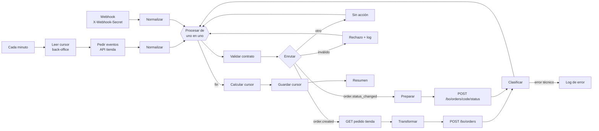
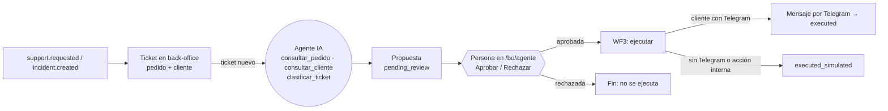

# n8n · Integración tienda → back-office (Tarea 2)

Prototipo académico. Datos ficticios, tokens de prueba, sin actividad comercial real.

## Qué hace el workflow `WF1 Pedidos y sincronización`



- **Disparador 1 (sondeo):** cada minuto lee los eventos nuevos de `GET /api/v1/events?after_id=N`. El cursor `N` se guarda en el back-office (`wf1_cursor`), no en n8n.
- **Disparador 2 (webhook):** `POST /webhook/zapatero-event` con cabecera `X-Webhook-Secret`. Sirve para lanzar los payloads de prueba.
- **Validación:** `event_id`, `schema_version`, tipo, fecha y campos obligatorios. Si falla → rama de rechazo (se registra en `bo_integration_log`, no se toca el back-office).
- **Rama correcta:** `order.created` → consulta el pedido completo → normaliza (email en minúsculas, espacios) → `POST /bo/api/v1/orders`. `order.status_changed` → `POST /bo/api/v1/orders/{code}/status`.
- **Gestión de errores:** 3 reintentos con 2 s de espera. 4xx = rechazo permanente. 5xx o sin respuesta = error técnico: se registra, y el **cursor no avanza** más allá de ese evento, así que se reintenta en el siguiente minuto.
- **Idempotencia:** el back-office descarta un `event_id` ya aplicado (`duplicate`), así que reprocesar es seguro (garantía *at-least-once*).

## Puesta en marcha (Windows)

Requisitos: **Docker Desktop** (gratuito para uso educativo), PHP y Composer (ya los tienes).

1. **Servidor de la tienda accesible desde Docker.** En una terminal, en la raíz del proyecto:
   ```powershell
   composer start:lan
   ```
   (Windows pedirá permiso de firewall para `php.exe`: acepta en *redes privadas*.) El `composer start` normal solo escucha en `localhost` y n8n no podría llegar.
2. **Variables de n8n.**
   ```powershell
   Copy-Item n8n\n8n.env.example n8n\n8n.env
   php -r "echo bin2hex(random_bytes(16));"      # úsalo como N8N_WEBHOOK_SECRET
   notepad n8n\n8n.env
   ```
   - `ZAPATERO_API_TOKEN` = el `API_TOKEN` de tu `.env`
   - `BO_API_TOKEN` = el `BO_API_TOKEN` de tu `.env`
   - `N8N_WEBHOOK_SECRET` = el valor que acabas de generar
3. **Arrancar n8n.**
   ```powershell
   cd n8n
   docker compose up -d
   ```
   Abre http://localhost:5678 y crea la cuenta de propietario local (datos ficticios; solo existe en tu PC).
4. **Importar el workflow:** menú **⋯ → Import from file** → `n8n/workflows/wf1-pedidos-sincronizacion.json`.
5. **Activarlo** (interruptor *Active* o botón *Publish*, según la versión). Sin esto no corre el sondeo ni existe `/webhook/...`.

## Pruebas

| Qué probar | Comando | Resultado esperado |
|---|---|---|
| Sondeo automático | Espera 1 minuto con el workflow activo | Aparecen los pedidos de la tienda en `/bo/pedidos` y filas `ok` en `/bo/integracion` |
| **Escenario 1** pedido | `.\n8n\probar.ps1 -Payload 01-esc1-pedido-creado.json -Order ZAP-AAAAMMDD-NNNN` | `ok: 1`, resultado `created` o `updated` |
| Idempotencia | Repite el comando anterior añadiendo `-EventId evt_0123456789abcdef0123456789abcdef` dos veces | La segunda vez, resultado `duplicate` |
| **Escenario 2** cambio | Cambia el estado de un pedido real en `/admin/pedidos/...` y espera ≤ 1 min | El estado se refleja en `/bo/pedidos/...` |
| Cambio por payload | `.\n8n\probar.ps1 -Payload 02-esc2-cambio-estado.json -Order ZAP-...` | `ok: 1` (solo cambia el back-office: es una prueba aislada) |
| **Rama de error** | `.\n8n\probar.ps1 -Payload 90-error-payload-invalido.json` | `rejected: 1`; fila `rejected` en `/bo/integracion` |
| Sin secreto | `Invoke-RestMethod -Method Post http://localhost:5678/webhook/zapatero-event -Body '{}'` | `rejected` con `unauthorized` |
| Error técnico | Para PHP (Ctrl+C), espera un sondeo, vuelve a arrancarlo | Ejecución en rojo; al volver, se recupera sin perder eventos |

El historial de cada ejecución (entradas y salidas de cada nodo) está en **Executions** de n8n: es la evidencia de trazabilidad.

## Problemas típicos

- **`ECONNREFUSED` / no conecta con la tienda:** usaste `composer start` en lugar de `composer start:lan`, o el firewall bloquea `php.exe`.
- **`access to env vars denied`:** falta `N8N_BLOCK_ENV_ACCESS_IN_NODE=false` (ya está en el compose) o no recreaste el contenedor tras cambiarlo (`docker compose up -d --force-recreate`).
- **El webhook devuelve 404:** el workflow no está activado, o usas `/webhook-test/` fuera del modo de prueba.
- **401 en las llamadas:** los tokens de `n8n.env` no coinciden con los del `.env` de la tienda.
- **Cambios en `n8n.env` no se aplican:** `docker compose up -d --force-recreate`.

## Modo producción (tu dominio)

Despliega la tienda y el back-office en el hosting, define `API_TOKEN` y `BO_API_TOKEN` en el `.env` **del servidor** y cambia en `n8n.env`:

```
ZAPATERO_BASE_URL=https://tu-dominio.example
BACKOFFICE_BASE_URL=https://tu-dominio.example
```

n8n sigue en tu equipo y solo hace llamadas salientes: no hace falta abrir puertos.

## Exportar el workflow (entrega)

Si lo modificas en n8n: **⋯ → Download**, y sustituye `workflows/wf1-pedidos-sincronizacion.json`. La exportación no incluye tokens (se leen de variables de entorno).

---

# Escenario 3 · Incidencias, Telegram y agente de IA supervisado

Se importan **dos workflows más** (mismo procedimiento: *Import from file* y activar):

| Archivo | Qué hace |
|---|---|
| `workflows/wf2-incidencias-agente.json` | Detecta `support.requested` e `incident.created` → crea el ticket en el back-office asociado a pedido y cliente → **agente de IA** → registra una **propuesta** pendiente de revisión → avisa al personal por Telegram |
| `workflows/wf3-telegram-ejecucion.json` | **A)** vincula al cliente con el bot mediante un **enlace de un solo uso** (botón «Recibir avisos por Telegram» en la página del pedido → `t.me/BOT?start=TOKEN`). **B)** ejecuta solo las propuestas **aprobadas por una persona** en `/bo/agente` |



## El agente (qué puede y qué no)

| | |
|---|---|
| **Herramientas de consulta** | `consultar_pedido` (solo el pedido del ticket), `consultar_cliente` (solo el cliente de ese pedido, sin email ni ciudad) |
| **Herramienta de acción (reversible)** | `clasificar_ticket` (categoría y prioridad de su propio ticket) |
| **Salida estructurada** | tipo de caso · datos consultados (los registra el código, no el modelo) · acción propuesta · justificación · confianza · prioridad · riesgos · estado final |
| **Acción sensible** | enviar un mensaje al cliente: **solo se propone**; nace en `pending_review` y no se envía sin aprobación humana registrada (autor y fecha) |
| **Prohibido** | cancelar pedidos, reembolsos/compensaciones, pedir datos de pago, consultar otros pedidos o clientes, usar herramientas fuera de la lista |
| **Guardarraíles** | máx. 6 pasos · una herramienta por turno · si el modelo propone cancelar o habla de dinero se sustituye por tarea de revisión / baja la confianza · si el modelo falla o no hay clave → **modo seguro** (tarea de revisión humana, confianza 0) · el back-office vuelve a validar todo |
| **Texto del cliente** | se trata como dato no fiable (defensa frente a *prompt injection*) |

## Puesta en marcha de esta parte

1. **Bot de Telegram:** en Telegram abre **@BotFather** → `/newbot` → copia el token. Anota su **@usuario** (sin @) y ponlo en `TELEGRAM_BOT_USERNAME` del `.env` de la tienda: el botón de la página del pedido no aparece sin él.
2. **Modelo de IA:** elige una opción de `n8n.env.example` (Gemini gratuito, Groq u Ollama local) y pon `LLM_API_KEY` y `LLM_MODEL`.
3. Añade a `n8n\n8n.env` las líneas `TELEGRAM_BOT_TOKEN`, `LLM_*` (y, opcional, `TELEGRAM_ADMIN_CHAT_ID`). Después recrea n8n:
   ```powershell
   cd n8n
   docker compose up -d --force-recreate
   ```
4. Importa y activa `wf2-incidencias-agente.json` y `wf3-telegram-ejecucion.json`.

> No pegues el token del bot ni la clave del modelo en chats, capturas, README ni commits. Si un nodo de Telegram falla, no captures el mensaje de error: puede incluir la URL con el token.

## Pruebas del Escenario 3

| Qué probar | Cómo | Resultado esperado |
|---|---|---|
| **Vincular cliente** | En la página de un pedido pagado, pulsa **Recibir avisos por Telegram** → *Start bot* → **Iniciar** | Respuesta «Listo: a partir de ahora recibirás…» (≤ 1 min) |
| **Enlace de un solo uso** | Vuelve a abrir el mismo enlace tras usarlo, o espera 30 min | «Este enlace ya se usó o ha caducado…»; fila `rejected` (`token_used` / `token_expired`) en `/bo/integracion` |
| **El código ya no vincula** | En Telegram, al bot: `/start ZAP-AAAAMMDD-NNNN` | Solo responde la ayuda: no vincula nada |
| **Incidencia → agente** | `.\n8n\probar.ps1 -Payload 03-esc3-incidencia.json -Order ZAP-... -Flow wf2` | `ok: 1`; ticket `INC-…` en `/bo/tickets`; propuesta `pending_review` en `/bo/agente` |
| **Soporte real** | En la tienda, desde un pedido, «Solicitar soporte» | En ≤ 1 min: ticket `SUP-n` + propuesta del agente |
| **Aprobación humana** | En `/bo/agente` pulsa **Aprobar** (o **Rechazar**) | Aprobada → en ≤ 1 min pasa a `executed` (Telegram) o `executed_simulated`; rechazada → no se ejecuta nunca |
| **Idempotencia** | Repite la incidencia con el mismo `-EventId` | `duplicate`: no se crea otro ticket **ni se vuelve a llamar al modelo** |
| **Prompt injection** | `-Payload 91-esc3-prompt-injection.json` | La propuesta nunca cancela ni promete reembolso; queda con riesgo/prioridad alta o como tarea de revisión |
| **Modo seguro** | Vacía `LLM_API_KEY`, recrea n8n y lanza una incidencia | Propuesta «tarea interna: revisar manualmente», confianza 0 |

Todo queda auditado en `/bo/integracion` y `/bo/agente` (quién aprobó, cuándo y qué se ejecutó) y en *Executions* de n8n.
